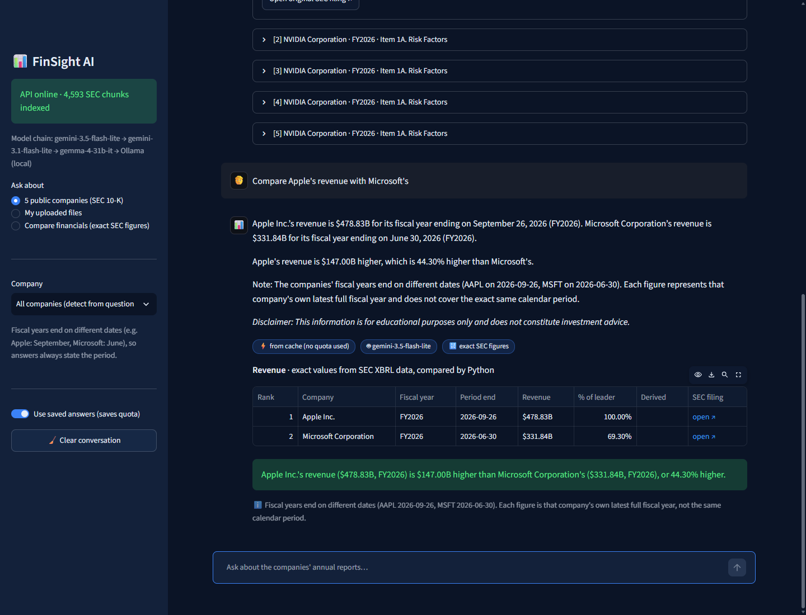
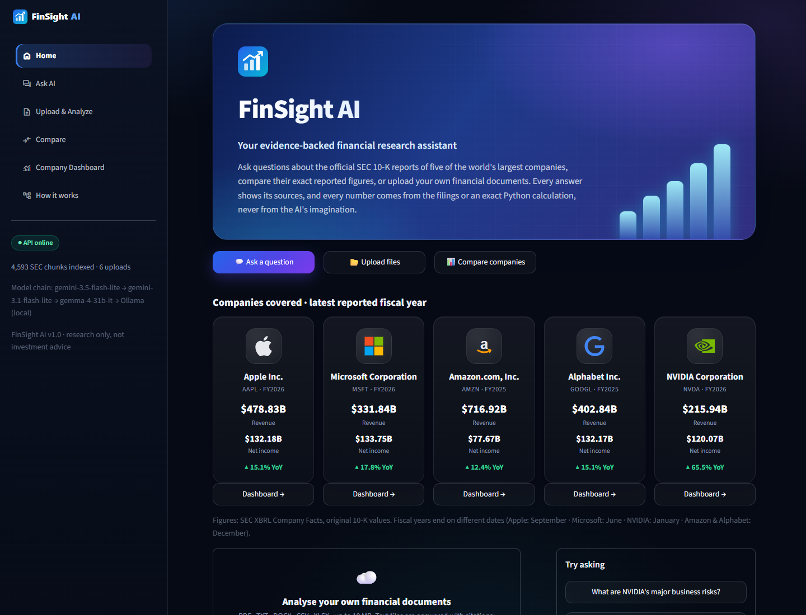
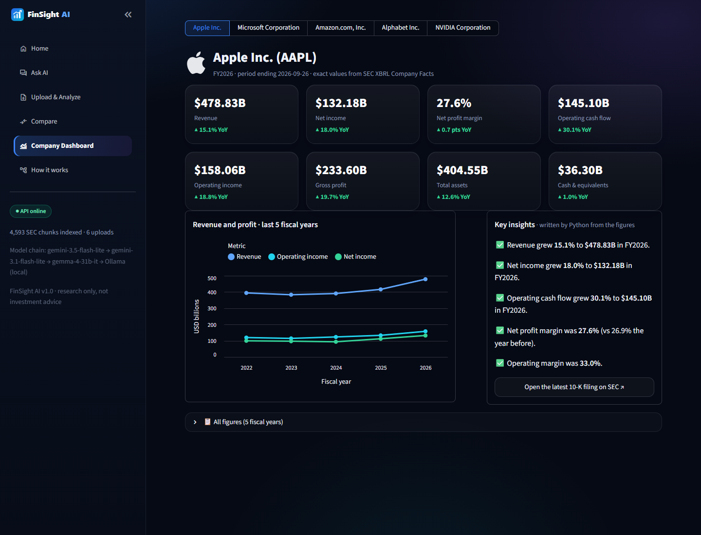
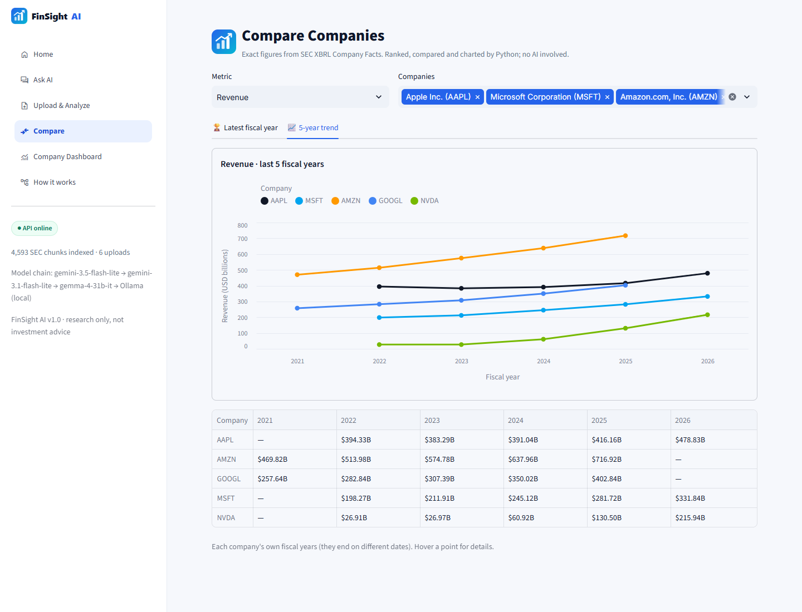
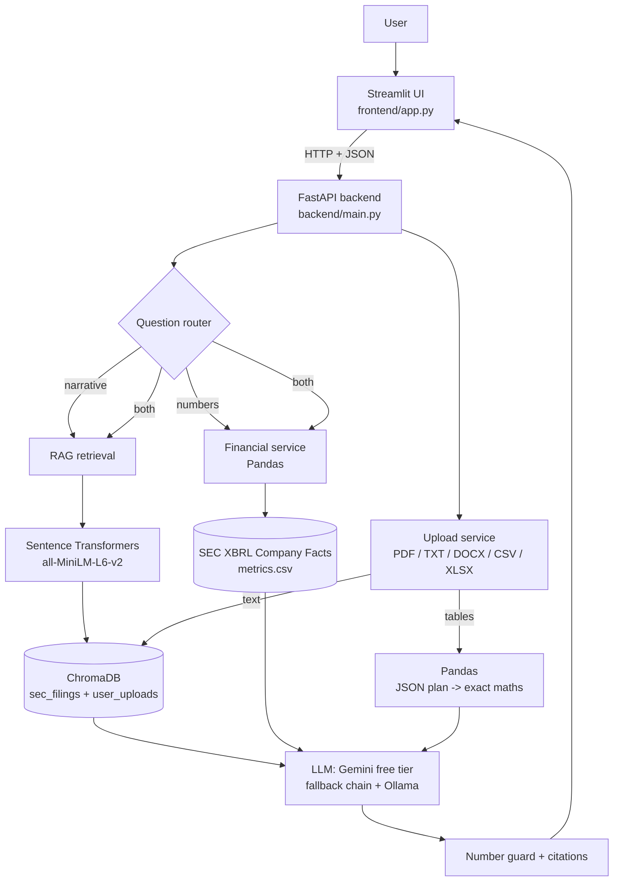
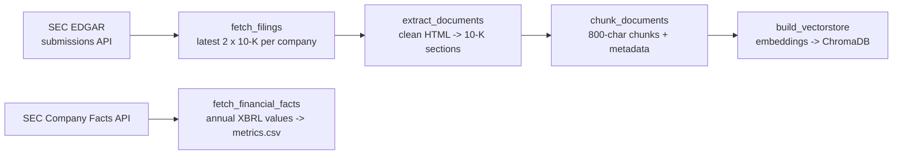

# FinSight AI

**An AI financial research assistant that answers questions about company annual reports with evidence, and never invents a number.**

FinSight AI reads the official SEC 10-K annual reports of **Apple, Microsoft, Amazon, Alphabet and NVIDIA**, plus any financial file you upload (PDF, TXT, DOCX, CSV, XLSX). It answers in plain English with **citations to the source documents**. Every figure comes either from the documents themselves or from an **exact Python calculation**. The AI explains numbers, but it never produces them.

> Research and information only, not investment advice.



---

## The problem

Annual reports run to hundreds of pages, and comparing companies means digging through several of them. A general chatbot can summarize, but it **hallucinates figures** and can't show where a claim came from. That's unacceptable for financial research.

**FinSight's approach:**
- **Retrieval-Augmented Generation (RAG):** the AI answers only from passages retrieved from the real filings, and cites them.
- **A separate structured-data pipeline:** official XBRL figures, compared with Pandas, for anything numeric.
- **Guards:** the system refuses to make up data and says clearly when information isn't available.

---

## Features

| Feature | What it does |
|---|---|
| **Ask about 5 companies** | Questions about risks, segments, strategy and management discussion, answered from 10-K text with numbered citations and links to the original SEC filing |
| **Exact financial figures** | Revenue, gross profit, operating income, net income, operating cash flow, total assets, total liabilities, cash, from SEC XBRL Company Facts |
| **Company comparisons** | Rankings, differences and % differences calculated by Python, with warnings when fiscal years end on different dates |
| **Question router** | Sends each question to the 10-K text (*narrative*), the exact figures (*numbers*), or *both* |
| **Orchestrator + 2 agents** | On Upload & Analyze, one Orchestrator reads your question and sends it to the Spreadsheet Agent (Excel/CSV, exact Pandas maths, picks the right sheet), the Document Agent (PDF/Word/TXT) or both, then merges one cited answer |
| **Your own files** | Upload PDF / TXT / DOCX (answered with RAG, cited by file and page) or CSV / XLSX (answered with **exact Pandas calculations**) |
| **Safe table maths** | The AI picks an operation from a whitelist as a JSON plan; Python validates and runs it. **No AI-generated code is ever executed** |
| **Number guard** | Every number in an AI answer is checked against the evidence; anything not found is flagged with a warning |
| **Quota Shield** | A free-tier fallback chain across Gemini models, an answer cache, and a local Ollama model as an offline last resort |
| **Honest failures** | Scanned PDFs, unsupported companies, unreported metrics and missing data are all stated clearly, never guessed |
| **Company Dashboard** | One company at a glance: 8 KPI cards with YoY change, net profit margin calculated by Python, a 5-year trend chart and key insights written by Python (not the AI) |
| **How it works page** | The router, both pipelines, upload handling, the Orchestrator, observability and guardrails (with the flow diagram and the guardrail table) and safeguards explained on one page |
| **Exact sources** | Every source shows its **full passage** inside the app, a **📖 Read the full section** popup with a search box, and a **📍 Open at this exact spot** link that opens SEC.gov scrolled to that sentence and highlighted (URL text fragment) |
| **Company Report** | A 10-section report per company (overview to sources), figures by Python, text by Gemini, missing points skipped. Ask "Audit report of Apple" or click 📑 on the Company Dashboard |
| **Year over year** | "Was Apple's 2026 profit better than 2025?" gets an exact table of both years with the change in $ and %, calculated by Python |
| **Answer trail** | Every answer has a "How this answer was made" panel (route, companies, model, cache, number-guard result, guardrails, request id) and a Download button |
| **Observability** | Every request gets a request id and one trace (route, timed steps, every AI call with model, latency and token counts, cache hit, fallbacks, guardrail actions) in a local JSON-lines file, shown on the **Monitoring page** with p50/p95 latency, cache hit rate, tokens per model and today's free-quota usage |
| **Guardrails** | Prompt-injection, investment-advice and off-topic questions are refused before any AI call; personal data (email, phone, card, Aadhaar, PAN, SSN) is redacted before anything reaches the AI; a daily AI budget and a per-minute rate limit; advice wording gets a disclaimer, leaked instructions are replaced, uncited answers are flagged |
| **Web API + UI** | FastAPI backend with interactive `/docs`, and a multi-page Streamlit app with company logos: Home · Ask AI · Upload & Analyze · Compare · Company Dashboard · How it works · Monitoring |

---

## Screenshots

| Home: the 5 companies with real SEC figures | Ask AI: exact figures + "How this answer was made" |
|---|---|
|  |  |
| **Company Dashboard (Python-written insights)** | **Compare: 5-year trend, no AI on this page** |
|  |  |

More in [`docs/screenshots/`](docs/screenshots/).

---

## Architecture



**Data ingestion (run once):**



### Orchestrator + 2 agents (Upload & Analyze)

One Orchestrator talks to the user; two specialist agents work in the background. Plain Python, no agent framework.

```
             user question (plain English)
                          │
                          ▼
         ┌──────────────────────────────────┐
         │           ORCHESTRATOR           │
         │ 1. reads the question + files    │
         │ 2. decides: which agent(s),      │
         │    which files, what task        │
         └───────┬──────────────────┬───────┘
                 ▼                  ▼
  ┌──────────────────────┐  ┌──────────────────────┐
  │  SPREADSHEET AGENT   │  │    DOCUMENT AGENT    │
  │ Excel / CSV          │  │ PDF / Word / TXT     │
  │ Gemini → JSON plan   │  │ search the passages  │
  │ Pandas → exact maths │  │ (RAG, ChromaDB)      │
  │ results [T1], [T2]   │  │ passages [1], [2]    │
  └──────────┬───────────┘  └───────────┬──────────┘
             └────────────┬─────────────┘
                          ▼
         ┌──────────────────────────────────┐
         │ ORCHESTRATOR: combine + check    │
         │ one answer with [T1] and [1]     │
         │ number guard on every figure     │
         └──────────────────────────────────┘
```

The Orchestrator decides with one small Gemini call (a JSON plan: which agent, which files, what task). Python
validates the plan; if Gemini is unavailable or the plan is unusable, rules decide (spreadsheets → Spreadsheet
Agent, documents → Document Agent). With only one type of file, no AI call is needed to decide.

### Two pipelines

| | Pipeline A: RAG | Pipeline B: structured figures |
|---|---|---|
| Source | 10-K **text** | SEC **XBRL** Company Facts |
| Best for | Risks, segments, strategy, "why" | Revenue, profit, assets, rankings, comparisons |
| Numbers come from | Quoted from the text (checked by the number guard) | **Python**, exactly as filed |

---

## Technology stack

| Layer | Tools |
|---|---|
| Language | Python 3.11 |
| Backend | FastAPI, Uvicorn, Pydantic |
| Frontend | Streamlit |
| LLM | Google Gemini API, free tier (`google-genai` SDK); local fallback: Ollama `llama3.2:3b` |
| Embeddings | Sentence Transformers `all-MiniLM-L6-v2` (384 dimensions, runs locally) |
| Vector database | ChromaDB (persistent, cosine similarity) |
| Data | SEC EDGAR submissions API, SEC XBRL Company Facts API |
| Processing | Pandas, BeautifulSoup + lxml, pypdf, python-docx, openpyxl |
| Testing | pytest, FastAPI TestClient, Streamlit AppTest |

Everything runs on free tools: no paid APIs and no billing.

---

## Data sources

- **SEC EDGAR submissions:** `https://data.sec.gov/submissions/CIK##########.json`, used to find the latest **two 10-K reports** per company.
- **10-K documents:** `https://www.sec.gov/Archives/edgar/data/...`. These are downloaded once, cached, and linked in every citation.
- **SEC XBRL Company Facts:** `https://data.sec.gov/api/xbrl/companyfacts/CIK##########.json`, the official tagged financial values.

| Company | Ticker | CIK | Fiscal year ends | Reports loaded |
|---|---|---|---|---|
| Apple | AAPL | 0000320193 | late September | FY2025, FY2026 |
| Microsoft | MSFT | 0000789019 | 30 June | FY2025, FY2026 |
| Amazon | AMZN | 0001018724 | 31 December | FY2024, FY2025 |
| Alphabet | GOOGL | 0001652044 | 31 December | FY2024, FY2025 |
| NVIDIA | NVDA | 0001045810 | late January | FY2025, FY2026 |

All SEC requests send an identifying `User-Agent`, stay under 5 requests per second (SEC's limit is 10), retry temporary errors with back-off, and are cached on disk.

---

## Installation

**Requirements:** Windows / macOS / Linux, **Python 3.11**, Git, about 2 GB of free disk space (plus 2 GB for the optional Ollama model). Optional: [Ollama](https://ollama.com) for the offline backup.

```bash
git clone https://github.com/Afraaz31/finsight-ai.git
cd finsight-ai
python -m venv .venv           # Windows: py -3.11 -m venv .venv
.venv\Scripts\activate         # macOS/Linux: source .venv/bin/activate
pip install -r requirements.txt
```

Optional offline backup model:

```bash
ollama pull llama3.2:3b
```

## Environment configuration

Copy `.env.example` to `.env` and fill in real values. **`.env` is git-ignored; never commit it.**

```
GEMINI_API_KEY=your_gemini_api_key_here          # free key from https://aistudio.google.com
GEMINI_MODEL=gemini-3.5-flash-lite
GEMINI_FALLBACK_MODELS=gemini-3.1-flash-lite,gemma-4-31b-it
SEC_USER_AGENT=FinSightAI your_email@example.com # SEC requires a real contact email
OLLAMA_ENABLED=false                             # true if Ollama + llama3.2:3b are installed
OLLAMA_MODEL=llama3.2:3b
OLLAMA_URL=http://localhost:11434
RATE_LIMIT_PER_MINUTE=20                         # questions per client per minute (HTTP 429 above)
DAILY_LLM_CALL_LIMIT=400                         # stop calling Gemini before the 500/day free quota
```

## Run the ingestion (once)

```bash
python -m ingestion.fetch_filings           # latest 2 x 10-K per company (cached)
python -m ingestion.extract_documents       # clean HTML -> sectioned JSON
python -m ingestion.chunk_documents         # sections -> overlapping chunks
python -m ingestion.build_vectorstore       # embeddings -> ChromaDB
python -m ingestion.fetch_financial_facts   # XBRL figures -> data/financial/metrics.csv
```

## Start the application

**One command (Windows):**

```powershell
powershell -ExecutionPolicy Bypass -File run_demo.ps1
```

**Or manually, in two terminals:**

```bash
uvicorn backend.main:app --port 8000        # API  -> http://127.0.0.1:8000/docs
streamlit run frontend/app.py               # UI   -> http://localhost:8501
```

**Demo-day helpers:**

```bash
python -m scripts.preflight                 # checks keys, data, models, servers (add --live for 1 Gemini call)
python -m scripts.prewarm                   # caches the demo questions' answers
```

---

## API endpoints

Interactive documentation: **http://127.0.0.1:8000/docs**

| Method | Path | Description |
|---|---|---|
| GET | `/health` | Readiness: chunk count, model chain, missing setup (no LLM call) |
| GET | `/companies` | Supported companies and available fiscal years |
| POST | `/chat` | `{"question": "...", "ticker": null}` → routed answer, sources, figures |
| GET | `/metrics` | Supported financial metrics |
| GET | `/financials/{ticker}` | All metrics for a company: latest + 5-year history with YoY change |
| POST | `/compare` | `{"tickers": ["AAPL","MSFT"], "metric": "revenue"}` → ranked comparison |
| GET | `/report/{ticker}` | The 10-section Company Report (`?fiscal_year=`); sections without data listed in `skipped` |
| GET | `/sec/sections` | The sections of one processed 10-K (`?ticker=&fiscal_year=`) |
| GET | `/sec/section` | The full text of one 10-K section (`?ticker=&fiscal_year=&section_id=8`) |
| POST | `/uploads` | Upload a file (multipart) → `doc_id` |
| GET | `/uploads` | List uploads |
| GET / DELETE | `/uploads/{doc_id}` | Details / delete an upload |
| POST | `/uploads/ask` | `{"question": "...", "doc_ids": ["..."]}` → answer from those files only |
| POST | `/assistant/ask` | `{"question": "...", "doc_ids": []}` → the Orchestrator picks the Spreadsheet Agent, the Document Agent or both (empty `doc_ids` = all uploaded files) |
| GET | `/observability/summary` | Requests, p50/p95 latency, cache hit rate, AI calls and tokens per model, fallbacks, guardrail actions, Gemini calls today vs the daily budget |
| GET | `/observability/traces` | Recent request traces, newest first (`?limit=&request_id=&questions_only=`) |

| Status | Meaning |
|---|---|
| 400 | Bad file (wrong type, too big, scanned PDF), or a question refused by a guardrail (the body names it in `guardrail`) |
| 404 | Unknown document or company |
| 422 | Invalid input, or a table question that can't be calculated |
| 503 | LLM, vector store or financial data unavailable (with a fix-it message) |

---

## Example questions

**10-K text (narrative)**
- What are NVIDIA's major business risks?
- Explain the business segments of Alphabet.
- Summarize the management discussion in Apple's annual report.

**Exact figures (numbers)**
- What was Apple's revenue in its latest reported fiscal year?
- Compare Apple's revenue with Microsoft's.
- Which company reported the highest net income?
- Compare the financial performance of all five companies.

**Both**
- Explain Amazon's operating income.
- apple 2026 was good or bad as compare to profits of 2025?? (year over year)

**Company Report**
- Audit report of Apple
- Company report on NVIDIA

**Uploaded files** (try the fictional samples in `samples/`)
- What was revenue in fiscal 2025 and how much did it grow? (`kestrel_annual_report.pdf`)
- What is the net profit margin for each year? (`kestrel_financials.csv`)
- What were the 3 biggest expenses in 2025? (`kestrel_statements.xlsx`, sheet *Expenses*)
- Does the revenue in the spreadsheet match the annual report? (both agents: `[T1]` + `[1]`)

**Honest refusals**
- What is Tesla's revenue? → not covered
- Should I buy Apple stock? → no investment advice
- Uploading a scanned PDF → "no readable text; OCR isn't supported"

---

## Testing

```bash
python -m pytest tests -v
```

**237 tests** cover:
- the ingestion traps (amendments, table of contents, hidden XBRL)
- chunking and retrieval filters
- RAG prompt building and citations
- the Quota Shield fallback chain and cache
- the number guard
- upload validation and safe table maths
- XBRL extraction traps (comparative years, quarterly values, tag changes, derived and stale values)
- the question router and the demo questions
- exact-spot links, full 10-K sections and audit-question retrieval
- the Company Report: routing, Python figures and ratios, skipped sections, auditor and founding year
- the Orchestrator and both agents (fake LLM): planner, rule fallback, plan validation, merged answers
- guardrails (injection, advice, off-topic, PII redaction, rate limit, daily budget, output checks) and observability (request ids, traces, token counts, fallbacks, the Monitoring page)
- every API endpoint and status code
- every page of the Streamlit UI (headless)

The LLM, the embedding model and the network are replaced with fakes where needed, so **tests use no API quota**.

| Requirement | Covered by |
|---|---|
| Apple / Microsoft revenue retrieval | `test_financials.py`, live checks against the 10-K |
| NVIDIA business risks | `test_demo.py` routing, live check |
| Amazon annual-report summary | section routing in `test_rag.py` |
| Apple vs Microsoft comparison; all five companies | `test_financials.py`, `test_demo.py` |
| Unavailable data / unsupported company | "does not report" notes, Tesla regression test in `test_demo.py` |
| Invalid API input | 422 tests in `test_api.py` |
| Missing API key | `test_rag.py` |
| Failed SEC request | `sec_client` retries 429/5xx with back-off and raises a clear `SECRequestError` (handled in code; not unit-tested) |
| Unsupported metric | 422 / `ValueError` tests in `test_financials.py` |

---

## Design decisions

1. **Numbers never come from the LLM.** XBRL values and Pandas calculations are exact; the LLM only explains them. The number guard flags any figure not found in the evidence.
2. **Per-company retrieval.** A comparison question retrieves evidence for each company separately, so one company can't crowd out the other.
3. **The LLM plans, Python executes.** For uploaded tables, the LLM fills in a whitelisted JSON plan instead of writing code, which prevents prompt injection from turning into code execution.
4. **Original 10-K values only.** For XBRL, each filing's own fiscal year is used (no repeated comparatives, no quarters, no amendments), and values more than a year out of date are treated as "not reported".
5. **Free-tier engineering.** A fallback chain across models with separate quotas, plus an answer cache and a local model, keeps the app working without billing.
6. **Thin API layer.** Pydantic schemas validate everything, routes call one service each, and central exception handlers map errors to HTTP codes.

## Limitations

- Covers 5 companies and their latest two 10-Ks. Other companies need re-running ingestion (the list is in `backend/companies.py`).
- No OCR: scanned PDFs are refused.
- One table per upload question; a table and a text document can't be mixed in one question.
- The keyword-based router can miss unusual phrasings.
- The free Gemini tier has daily limits and may use inputs for training, so only upload public or sample data.
- XBRL comparisons use each company's own fiscal year, which isn't the same calendar period.
- The guardrails are regex rules: cleverly worded attacks can slip past them, and a bare 10-digit number starting with 6-9 is redacted as a phone number. That's why there are several layers (system prompt, plan validation, no code execution, number guard).

## Future improvements

- Quarterly (10-Q) data and more metrics (EPS, margins, segment revenue)
- OCR for scanned documents
- Hybrid search (BM25 + embeddings) and re-ranking
- Charts of multi-year trends in the chat
- Authentication and per-user upload storage
- Docker deployment
- OpenTelemetry export of the traces to a tool like Langfuse or Grafana, and a model-based safety classifier (e.g. Llama Guard) for subtler attacks than the rule-based guardrails catch

---

## Project structure

```
finsight-ai/
├── backend/            FastAPI app, routes, schemas, services (RAG, LLM, financials, uploads, reports)
│   ├── agents/         Level 12: orchestrator, spreadsheet_agent, document_agent
│   ├── observability.py, guardrails.py   Level 13: traces + checks around every AI call
├── ingestion/          SEC download, HTML cleaning, chunking, vector store, XBRL facts
├── frontend/           Streamlit UI (talks only to the API)
│   ├── app.py          entry: page config, theme, logo, navigation, API status
│   ├── ui.py           shared design: CSS, cards, answer rendering, sources, trail, cached API data
│   ├── logos.py        FinSight + company logos (inline SVG, work offline)
│   ├── api_client.py   HTTP calls to FastAPI
│   ├── assets/         finsight_logo.svg, finsight_mark.svg (generated from logos.py)
│   └── views/          home · ask · upload · compare · dashboard · how_it_works · monitoring
├── scripts/            CLI tools: ask, upload_cli, search_test, preflight, prewarm, check_gemini, sec_test, inspect_processed
├── tests/              pytest suite (237 tests)
├── samples/            fictional sample files for testing uploads
├── docs/               interview guide, screenshots
├── data/  vectorstore/ generated (git-ignored)
├── run_demo.ps1        one-command start (Windows)
└── requirements.txt
```

## Author

**Afraaz Ahmed** · [GitHub](https://github.com/Afraaz31) · [LinkedIn](https://linkedin.com/in/afraaz-ahmed31)
